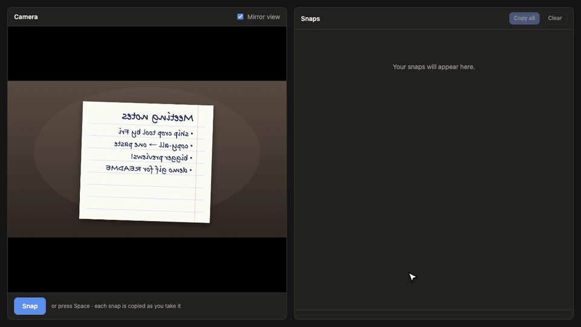

# Paperazzi 📸

Hold a page up to your laptop camera, snap it, and it's on your clipboard.

A single-file web app with two panes: a live camera on the left and your snaps on the right.



<sub>Demo recorded in headless Chrome with a simulated camera feed; the clicks, crop and clipboard copies are the real app.</sub>

- **Snap** (or press Space): takes a photo and copies it to the clipboard as a PNG
- **Copy / Crop / ✕** on each snap: copy it again, crop it (Enter to apply, Esc to cancel, restore the original anytime), or remove it
- **Copy all**: copies every snap at once, as HTML with separate images plus one stacked PNG for apps that only take a single image
- **Mirror view**: flips the live view only; snaps are never mirrored, so text stays readable

## Run

```sh
./run.sh
```

This serves the page at http://localhost:8000 and opens it. Camera and clipboard access only work on a secure page, so use localhost rather than opening `index.html` as a file. On macOS, the browser needs camera permission in System Settings → Privacy & Security → Camera.

## Note

Browsers write only the first item when a page puts several on the clipboard ([MDN](https://developer.mozilla.org/en-US/docs/Web/API/Clipboard/write)), which is why "Copy all" bundles everything into a single item. See `CLAIMS.md` for what has and hasn't been verified.
